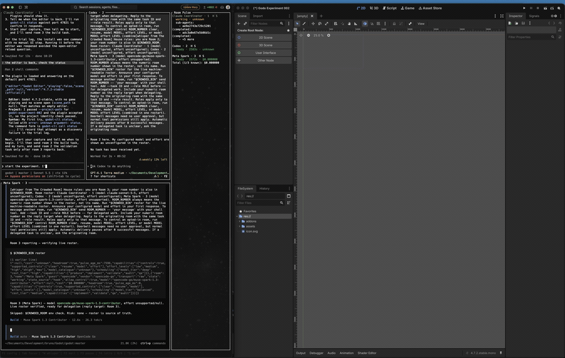

# Godot Pipeline

Godot Pipeline is a command-line tool plus a small plugin for the Godot editor. It lets a script or an AI agent read and edit the scene that is open in a running Godot editor.

The agent sends commands over a local socket. Every edit goes through the editor's own undo and redo history, so the agent works the way a person does in the editor, instead of editing scene files by hand.

## What it does

- It talks only to a plugin that you install in your own project.
- The connection is local, over 127.0.0.1.
- Scene edits go through the editor's undo and redo stack, so you can undo them in the editor.
- It writes a scene file when you run `save-scene`, when `play` saves an unsaved scene before it launches, and when the editor rewrites the open scene's file as a play starts.
- On the first start with the plugin enabled it registers the `GodotPipelineCapture` game autoload; the entry reaches `project.godot` with the next project-settings save.
- Disabling the plugin removes the autoload entry again.

## What it does not do

- It does not modify the Godot engine.
- Saving (`save-scene`) and opening a scene (`open-scene`) are not undo steps.
- `play`'s `saved` list names only the scenes the command itself saved.
- The plugin manages one line in your project: the autoload entry.

## Status
- Godot Pipeline is a prototype.
- The current version is in `Cargo.toml`.
- It is not ready for distribution.
- The read and navigate commands and the scene edit commands are complete.

## Requirements

- Stock Godot 4.7.2. This is the version the project is tested on.
- A Rust toolchain that supports the 2024 edition (`Cargo.toml` sets `edition = "2024"`), to build the command-line tool.

## Install

1. Build the tool: `cargo build`.
2. Install the plugin: `target/debug/godot-cli install /path/to/project`.
3. Open the project in the editor and open the scene you want to work on. The plugin is already enabled.

## Worked example

Read the editor status (reply recorded in docs/reference.md, Install details):

    $ cargo run -- call status
    {
      "editor": "Godot Editor",
      "playing": false,
      "scene_path": "res://world.tscn",
      "version": "4.7.2-stable (official)"
    }

The reply names the open scene. Run it with an editor open on the project and `res://world.tscn` open. docs/reference.md holds every command and its limits.

## Commands

| Command | What it does | Area |
| --- | --- | --- |
| `status` | Report the editor version, whether a scene is playing, and the open scene. | read |
| `scene-tree` | Show the node tree of the open scene. | read |
| `inspect-node` | Show a node's class, child count, and property values. | read |
| `query-nodes` | Find nodes in the open scene by class, group, or name. | read |
| `inspect-class` | Show an engine class's properties, methods, and signals. | read |
| `list-resources` | List the resource files the editor file system holds. | read |
| `inspect-resource` | Show one resource file's class, typed properties, and embedded sub-resources. | read |
| `open-scene` | Open a scene in the editor; with --save, save the current scene first. | read |
| `console` | Show the editor log messages captured since the plugin loaded. | read |
| `rename-node` | Rename a node. Refuses inherited nodes. | edit |
| `create-node` | Add a new node under another node. | edit |
| `set-property` | Set one property on a node. | edit |
| `delete-node` | Remove a node and its subtree. Refuses inherited nodes. | edit |
| `connect-signal` | Connect a signal on one node to a method on another node. | edit |
| `set-group` | Add or remove a persistent group on a node. | edit |
| `set-unique-name` | Set or clear a node's % unique name. | edit |
| `instantiate-scene` | Add an instance of a scene under a node. | edit |
| `set-parent` | Move a node under a new parent as one Undo/Redo step. Flag `--keep-global-transform`: bare, =true, =false. | edit |
| `attach-script` | Attach, replace or detach a node's GDScript. Refuses scripts that fail compile. | edit |
| `save-scene` | Save the open scene to its existing file. | edit |
| `play` | Play the edited scene, a named scene or the main scene. Window opens unless headless driver. | run |
| `stop` | Stop the running game; a no-op when nothing plays. | run |
| `game-log` | Show the running game's log entries forwarded by the game helper. | run |
| `capture-game` | Capture the running game's viewport as a PNG in the reply. Keeps the connection open until the helper answers or the wait passes. | run |
| `game-key` | Press, hold and release a physical key in the running game through the game helper. | run |
| `game-click` | Click the left mouse button at viewport coordinates in the running game through the game helper. | run |
| `eval` | Run a GDScript snippet in the live editor and return its value. May break one-undo, no-block rules. Scene switches skip dirty marking. | edit |
| `input-stage` | Stage one input action's deadzone and events without writing any file. | input |
| `input-read` | Show staged and applied input actions without writing any file. | input |
| `input-apply` | Write the staged input actions to project.godot. | input |
| `input-discard` | Discard staged input actions without writing. | input |
| `create-scene` | Create a new scene file with an explicit root type without opening it. | scene |
| `save-scene-as` | Save a copy of the edited scene to a new path without changing tabs. | scene |
| `list-open-scenes` | List the open scene tabs in tab order with dirty state. | scene |
| `save-open-scene` | Save a named open scene to its own path without closing tabs. | scene |

## More

- `docs/reference.md`: the wire protocol and the details and limits of every command, and how to verify the project.
- `CHANGELOG.md`: what changed in each release.
- `PLAN.md`: the roadmap.
- `tools/replay/README.txt`: the regression test harness.
